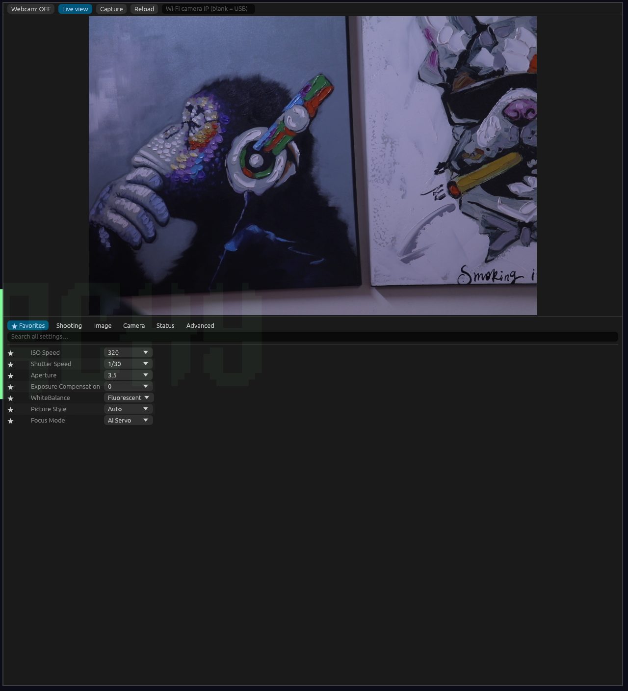

# OpenEOS

OpenEOS is a desktop app for a Canon EOS camera. It uses the gphoto2 program to talk to the camera.



The app has these functions:

- Change camera settings in tabs. Mark the settings you use most as favorites.
- Show live view in the app window.
- Take a photo and save the full RAW file.
- Use the camera as a webcam.
- Connect to the camera through USB or Wi-Fi.

Canon did not make this app and does not support it. The developer tested it with a Canon EOS 80D on Linux only.

## Requirements

| System | Required programs |
|---|---|
| Linux | `gphoto2`, `ffmpeg`, the `v4l2loopback` kernel module, Rust |
| macOS | `gphoto2`, `ffmpeg`, OBS Studio, Rust |
| Windows | Not supported. gphoto2 has no native Windows build. WSL2 may work. |

The app shows the install command for your system when a program is missing.

Linux install commands:

- Arch: `sudo pacman -S gphoto2 ffmpeg v4l2loopback-dkms`
- Debian and Ubuntu: `sudo apt install gphoto2 ffmpeg v4l2loopback-dkms`
- Fedora: `sudo dnf install gphoto2 ffmpeg`. Get `v4l2loopback` from RPM Fusion.

macOS install command: `brew install gphoto2 ffmpeg`

## Build and run

```
cd canon-settings
cargo build --release
./target/release/canon-settings
```

## Add a launcher on Linux

1. Copy `canon-settings/target/release/canon-settings` to `~/.local/bin/openeos`.
2. Copy `openeos.desktop` to `~/.local/share/applications/`.

Your application launcher then lists OpenEOS.

## Prepare the webcam on Linux

The webcam function writes video to `/dev/video10`. Load the `v4l2loopback` module with these steps:

1. Copy `v4l2loopback-load.conf` to `/etc/modules-load.d/v4l2loopback.conf`.
2. Copy `v4l2loopback-options.conf` to `/etc/modprobe.d/v4l2loopback.conf`.
3. Restart the computer, or run `sudo modprobe v4l2loopback exclusive_caps=1 card_label="Canon 80D" video_nr=10`.

## Use the app

1. Connect the camera with a USB cable and start it.
2. Start the app. The app reads the camera settings.
3. Select a tab to see a group of settings. Select the star next to a setting to add it to Favorites.
4. Select **Live view** to see the camera picture.
5. Select **Capture** to take a photo. The app saves the file in `~/Pictures/Canon80`.
6. Select **Webcam** to send the camera picture to other programs.

The camera saves RAW files only when its Image Format setting is RAW. If the setting is a JPEG format, the app tells you.

The app saves your favorites in `~/.config/canon-settings/favorites`.

### Webcam on macOS

macOS has no `v4l2loopback`. The app sends the picture to `udp://127.0.0.1:5600`. The macOS function is not tested. To use it:

1. In OBS, add a Media Source with the address `udp://127.0.0.1:5600`.
2. Set the input format to `mjpeg` and turn off buffering.
3. Select **Start Virtual Camera** in OBS.

## Use Wi-Fi

1. Connect the camera to your Wi-Fi network. Choose the option that connects it to a computer.
2. Find the camera IP address. The camera screen shows it, or you can run `avahi-browse -rt _ptp._tcp`.
3. Enter the IP address in the **Wi-Fi camera IP** box. Press Enter.
4. Approve the new computer on the camera if it asks.

To use USB again, clear the box.

The camera accepts one Wi-Fi session at a time. Do not run other programs that connect to the camera while the app runs.

## Known limits

- Live view over USB has a maximum size of 960 by 640 pixels and about 30 frames each second. A higher size needs an HDMI capture card.
- The webcam picture has a small delay. The camera and the video programs cause it.
- The app cannot set the focus point with a click.
- The app stops live view for a short time each time you change a setting or take a photo.
- The macOS webcam function is not tested.
